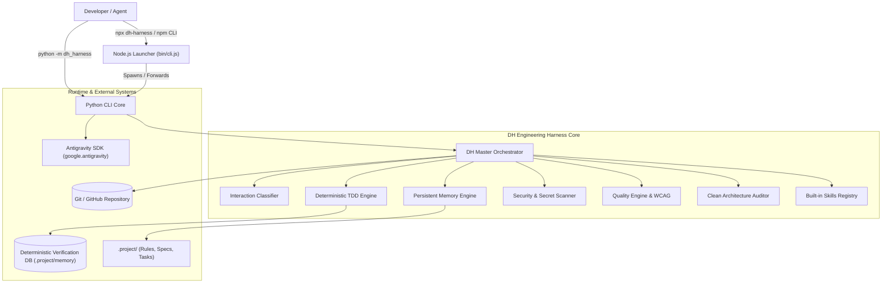
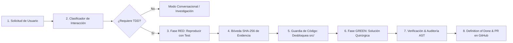

# DH Engineering Harness for Google Antigravity

[](package.json)
[](LICENSE)
[](https://www.python.org/)
[](https://nodejs.org/)
[](tests/)
[](#project-health-dashboard)
[](#security--spdx-license-whitelist)

**DH Engineering Harness** es una plataforma integral de ingeniería de software orientada a agentes para **Google Antigravity**. Proporciona gobernanza determinista de tareas, ciclo TDD estricto con verificación de evidencias criptográficas, orquestación de flujos de trabajo sobre grafos acíclicos dirigidos (DAG), memoria persistente multi-nivel, catálogo de skills y agentes preempaquetados de fábrica, y auditoría continua de Clean Architecture, seguridad y calidad.

---

## Filosofía de Ingeniería

> **"Mínimo proceso necesario, máximo rigor cuando se modifica software."**

El arnés no burocratiza preguntas conceptuales ni omite controles en modificaciones de código productivo:
1. **Calidad antes que velocidad aparente:** Cada paso debe superar una verificación determinista objetiva.
2. **TDD obligatorio:** Prohibido modificar código en `src/` sin haber registrado previamente la falla en fase RED.
3. **Evidencia antes que afirmaciones:** Ninguna tarea se marca como completada sin pruebas y Definition of Done (DoD) verificada.
4. **Clean Architecture irrestricta:** Thin controllers, aislamiento de repositorios en Infraestructura y cero datos simulados o mocks en producción.
5. **Seguridad desde el diseño:** Escaneo AST de secretos, bloqueo de SQL destructivo y dependencias 100% permisivas (SPDX Whitelist).

---

## Arquitectura del Sistema

### 1. Diagrama de Contexto de Sistema (C1)



### 2. Ciclo de Ejecución Determinista TDD (C3)



---

## Características Principales y Motores Integrados

El harness incorpora 11 motores especializados coordinados por el **Master Orchestrator**:

1. **Interaction & Task Classification Engine (`src/dh_harness/interaction/`):**
   - Clasifica solicitudes en 5 modos canónicos: `CONVERSATIONAL`, `INVESTIGATION`, `BUG_FIX`, `DEVELOPMENT`, `COMPLEX_ENGINEERING`.
   - Modula el rigor automáticamente: no inicia ceremonias pesadas para preguntas teóricas y activa TDD estricto para código.

2. **Deterministic TDD Engine (`src/dh_harness/tdd/`):**
   - **Bóveda de Evidencia RED (`RedEvidenceVault`):** Registra el hash SHA-256 de la ejecución fallida de la prueba antes de permitir cambios en código.
   - **Guardia de Modificación (`CodeModificationGuard`):** Bloquea cualquier edición en `src/` si no existe evidencia previa de prueba en rojo.
   - **Detector de Pruebas Falsas (`FalseTestDetector`):** Analiza el árbol sintáctico (AST) para erradicar tests cosméticos (tests vacíos, sin aserciones o con `assert True`).

3. **Master Orchestrator, DAG & Continuity (`src/dh_harness/orchestrator/`, `tasks/`, `continuity/`):**
   - Organiza tareas en un grafo acíclico dirigido (DAG) con ordenamiento topológico y detección de ciclos.
   - Responde dinámicamente a la pregunta: *"¿Con qué continuamos hoy?"* recomendando la siguiente tarea desbloqueada (`dh-harness continue`).

4. **Hierarchical Persistent Memory Engine (`src/dh_harness/memory/`):**
   - Gestión de memoria en 4 niveles: L1 (Scratchpad de sesión), L2 (Memoria de proyecto `.project/`), L3 (Memoria de tarea activa), L4 (Conocimiento a largo plazo en SQLite).
   - Checkpoints con checksum SHA-256 y Truncation Guard con digest compacto para prevenir desbordamientos de contexto.

5. **Clean Architecture & Layer Boundary Auditor (`src/dh_harness/architecture/`):**
   - Audita estáticamente el código fuente para impedir el bypass de capas:
     - Detecta e intercepta accesos o importaciones directas de bases de datos (`DbContext`, `dapper`, `sqlite3`) dentro de controladores (`DIRECT_DB_ACCESS_IN_CONTROLLER`).
     - Detecta consultas SQL embebidas en controladores (`SQL_IN_CONTROLLER`).

6. **Security & Secrets Engine (`src/dh_harness/security/`):**
   - Escáner AST de secretos que detecta tokens de GitHub, llaves de AWS, private keys o passwords en connection strings.
   - Auditor de licencias de dependencias según lista blanca SPDX (100% permisivas: `MIT`, `Apache-2.0`, `BSD`, `ISC`).
   - Guardia contra sentencias SQL destructivas (`DROP`, `TRUNCATE`, `DELETE` sin `WHERE`).

7. **Quality Engine & WCAG 2.1 AA Accessibility (`src/dh_harness/quality/`, `uiux/`):**
   - Quality gates que consolidan pruebas unitarias, auditoría AST y validación de entregables.
   - Auditor de accesibilidad web que evalúa contraste de color (ratio mínimo 4.5:1), etiquetas ARIA y estados de carga (`loading`, `empty`, `error`).
   - Aislamiento estricto de revisión: el agente desarrollador nunca puede auto-aprobar su código (`SelfReviewViolationError`).

8. **Architecture Decision Records (ADRs) & C4 Generator (`src/dh_harness/docs/`):**
   - Descubrimiento, numeración incremental automática y validación estructural de ADRs en `docs/decisions/`.
   - Generación de diagramas C4 (Contexto C1 y Contenedores C2) en Mermaid nativo.

9. **Git & Repository Governance (`src/dh_harness/git/`):**
   - Validación de Conventional Commits (`feat(...)`, `fix(...)`).
   - Verificación de Definition of Done (DoD) con recolección de evidencias antes de cerrar tareas.
   - Soporte para ejecución concurrente mediante Git Worktrees aislados.

10. **Lifecycle Hooks Engine (`src/dh_harness/hooks/`):**
    - Puntos de intercepción configurables en `.agents/hooks.json` para eventos: `SESSION_START`, `PRE_TASK`, `POST_TASK` y `SESSION_END`.

11. **Project Health Engine (`src/dh_harness/health/`):**
    - Diagnóstico multidimensional ponderado (0.0% a 100.0%) en 6 pilares de ingeniería, certificando preparación para producción.

---

## Ecosistema Preempaquetado: Skills y Agentes de Fábrica

El harness incluye de fábrica en la carpeta `.agents/` los 9 skills de ingeniería y el catálogo de agentes especializados. **No requieren instalación por separado ni descargas adicionales:**

### Catálogo de Skills Incorporados (`.agents/skills/`)

El arnés cuenta con **18 skills oficiales de ingeniería** empaquetados de fábrica:

| Skill ID | Especialidad | Triggers | Reglas Clave |
| :--- | :--- | :--- | :--- |
| **`clean-architecture-backend`** | Backend & APIs | `backend`, `api`, `clean-architecture`, `repository` | Thin controllers, repositorios en Infraestructura, cero datos falsos. |
| **`database-migrations-dapper-ef`**| Datos & Migraciones | `database`, `sql`, `migration`, `dapper`, `ef-core` | Migraciones idempotentes y transaccionales, queries parametrizadas, seed data real. |
| **`modern-frontend-ui`** | Frontend & UI/UX | `frontend`, `ui`, `react`, `angular`, `wcag`, `a11y` | Accesibilidad WCAG 2.1 AA, estados loading/error, consumo de APIs reales. |
| **`system-architecture-c4`** | Arquitectura & C4 | `architecture`, `c4`, `adr`, `system-design` | Diagramas Mermaid Contexto y Contenedor, gestión estandarizada de ADRs. |
| **`appsec-threat-modeling`** | Seguridad & AppSec | `security`, `threat-modeling`, `owasp`, `secret`, `spdx` | Escáner AST de secretos, lista blanca SPDX, bloqueo de SQL destructivo. |
| **`tdd-test-automation`** | TDD & Testing | `tdd`, `test`, `pytest`, `unit-test`, `red-green` | Falla previa RED en bóveda SHA-256, cero tests cosméticos o tautológicos. |
| **`git-governance`** | Git & DoD | `git`, `branch`, `commit`, `dod`, `worktree` | Ramas `feature/*`, Conventional Commits, verificación de DoD con evidencias. |
| **`quality-engineering`** | Calidad & Gates | `quality`, `qa`, `code-review`, `gate` | Revisión independiente obligatoria (anti-self-review), quality gates. |
| **`orchestrator-continuity`** | Orquestación & DAG | `orchestrator`, `classify`, `continue`, `dag` | Clasificación en 5 modos, resolución DAG, "¿Con qué continuamos?". |
| **`dotnet-clean-architecture`** | .NET & C# Enterprise | `dotnet`, `c#`, `aspnet`, `dapper`, `efcore` | CQRS, Thin controllers, AsNoTracking en lecturas, consultas parametrizadas. |
| **`python-fastapi-clean-architecture`** | Python & FastAPI | `python`, `fastapi`, `pydantic`, `sqlalchemy` | Schemas Pydantic v2 estrictos, sesiones async, inyección de dependencias. |
| **`angular-enterprise-ui`** | Angular 18+ Enterprise | `angular`, `rxjs`, `signals`, `ngrx` | Standalone components, Signals, OnPush change detection, accesibilidad WCAG. |
| **`react-nextjs-ui`** | React 19 & Next.js | `react`, `nextjs`, `tailwind`, `server-components` | Server/Client boundaries, loading skeletons, TanStack Query tipado. |
| **`mobile-flutter-engineering`** | Mobile Multiplataforma | `flutter`, `dart`, `mobile`, `android`, `ios`, `bloc` | Clean Architecture móvil (Domain, Data, Presentation), BLoC, offline-first. |
| **`postgresql-database-specialist`** | PostgreSQL Avanzado | `postgres`, `postgresql`, `psql`, `jsonb`, `gin-index` | Índices GIN/BRIN, particionamiento, migraciones transaccionales idempotentes. |
| **`sqlserver-database-specialist`** | SQL Server Enterprise | `sqlserver`, `sql-server`, `tsql`, `t-sql` | RCSI snapshot isolation, índices columnares, planes de ejecución sin deadlocks. |
| **`devops-ci-cd-pipelines`** | CI/CD & Delivery | `cicd`, `ci-cd`, `github-actions`, `azure-pipelines` | Quality gates fail-fast, caching de dependencias, Least Privilege OIDC. |
| **`docker-kubernetes-iac`** | Contenedores & Cloud | `docker`, `kubernetes`, `k8s`, `helm`, `terraform` | Dockerfiles multi-stage no-root, health probes en K8s, infraestructura Terraform. |

### Catálogo de Agentes Especializados (`.agents/agents/catalog.json`)

El arnés cuenta con **14 agentes especializados** con roles y herramientas delimitadas:

- **`chief-orchestrator`:** Coordinador general, clasificador de intenciones y despachador de tareas.
- **`solution-architect`:** Diseñador de arquitectura C4, auditor de límites de capas y redactor de ADRs.
- **`developer-backend` / `senior-backend-engineer`:** Especialista general en backend y Clean Architecture.
- **`dotnet-lead-engineer`:** Especialista líder en .NET 8/9, C#, ASP.NET Core, EF Core y Dapper.
- **`python-lead-engineer`:** Especialista líder en Python 3.12, FastAPI, Pydantic v2 y SQLAlchemy async.
- **`developer-frontend` / `senior-frontend-engineer`:** Diseñador general de interfaces web modernas.
- **`react-frontend-lead`:** Especialista líder en React 19, Next.js App Router y Server Components.
- **`angular-frontend-lead`:** Especialista líder en Angular 18+, Signals y Standalone Components.
- **`mobile-engineer`:** Especialista en aplicaciones móviles nativas y Flutter multiplataforma con BLoC.
- **`database-engineer`:** DBA especialista en esquemas relacionales y optimización de consultas.
- **`devops-cloud-engineer`:** Especialista en pipelines CI/CD, Dockerfiles no-root, Kubernetes y Terraform.
- **`qa-engineer`:** Diseñador de pruebas unitarias, auditor de tests falsos y planes de prueba.
- **`independent-code-reviewer`:** Revisor independiente de código y arquitectura (anti-self-review).
- **`security-auditor` / `security-engineer`:** Auditor de secretos AST, licencias SPDX y seguridad fail-closed.

### Catálogo de Workflows Componibles (`src/dh_harness/workflows/`)

Flujos ejecutables de ciclo completo auditados paso a paso:
1. **`feature-development`:** Especificación C4 -> TDD RED -> Implementación GREEN -> Revisión independiente.
2. **`bug-fix`:** Reproducción de defecto en RED -> Corrección mínima GREEN -> Revisión independiente.
3. **`security-audit`:** Escaneo AST de secretos -> Threat modeling STRIDE -> Plan de remediación arquitectónica.
4. **`api-development`:** Modelado y migración de BD -> Contrato TDD -> Endpoint HTTP -> Revisión independiente.
5. **`mobile-feature-development`:** Especificación móvil -> BLoC State TDD RED -> Implementación Flutter GREEN -> QA Review.
6. **`devops-pipeline-release`:** Auditoría de IaC/Dockerfile -> Definición de Pipeline CI/CD -> Quality Gate -> Despliegue.
7. **`architecture-refactoring`:** Auditoría de capas -> Pruebas de caracterización RED -> Refactor GREEN -> Revisión.

---

## Instalación y Arranque Rápido

### Requisitos Previos
- **Node.js:** `>= 18.0.0`
- **Python:** `>= 3.10`
- **Git**

### Opción A: Ejecución Directa con `npx` (Sin instalación global)
```bash
# Diagnóstico de salud del proyecto
npx dh-harness health

# Consultar continuidad ("¿Con qué continuamos?")
npx dh-harness continue

# Ver catálogo de skills incorporados
npx dh-harness skills list
```

### Opción B: Instalación Global vía npm
```bash
npm install -g dh-harness
dh-harness --help
```

### Opción C: Instalación en Entorno Python
```bash
git clone https://github.com/omardelahoz/DH.Harness.git
cd DH.Harness
python -m venv .venv
.\.venv\Scripts\activate   # En Linux/macOS: source .venv/bin/activate
pip install -e ".[dev]"
```

### Inicialización de un Proyecto Nuevo o Existente
Para preparar cualquier proyecto de software con la estructura de gobierno, memoria y skills preempaquetados:
```bash
dh-harness init
```
Este comando siembra automáticamente:
- La carpeta `.project/` (rules, specs, tasks, memory, status).
- La carpeta `.agents/` con los 9 skills oficiales, catálogo de agentes y reglas de ingeniería.
- La base de datos SQLite para verificación determinista de tareas.
- Las guías maestras de operación `AGENTS.md` y `GEMINI.md`.

---

## Manual de Referencia de la CLI

```text
CORE COMMANDS:
  health                     Diagnóstico holístico de 6 pilares de salud del proyecto (100% GA score)
  status                     Muestra el estado del proyecto, tareas activas y memoria
  continue, next             Diagnostica continuidad y recomienda la siguiente tarea ("¿Con qué continuamos?")
  init [--force]             Inicializa el workspace con .project/, .agents/ y la base de verificación
  classify "<prompt>"        Clasifica una solicitud en uno de los 5 modos de interacción
  check                      Ejecuta suite de quality gates y pruebas unitarias

ENGINEERING SUITES:
  skills list                Muestra la tabla de los 9 skills de ingeniería incorporados
  skills show <id>           Muestra la especificación completa, triggers y reglas de un skill
  skills match "<prompt>"    Determina dinámicamente qué skills aplican a una tarea según triggers
  agents list                Lista los agentes especializados y sus herramientas permitidas
  agents show <id>           Muestra permisos, habilidades requeridas y criterios de evaluación de un agente
  tdd audit-tests [path]     Audita la suite de pruebas para detectar tests falsos o cosméticos
  git check-dod <task_id>    Verifica los criterios de Definition of Done para una tarea
  git validate-commit "<msg>" Valida sintaxis Conventional Commits
  sec scan [path]            Escanea el código fuente en busca de secretos y credenciales expuestas
  sec licenses [dir]         Audita licencias de dependencias contra la lista blanca SPDX
  quality audit              Ejecuta auditoría multidimensional de calidad
  docs adr list              Lista todas las decisiones arquitectónicas registradas (ADRs)
  docs adr new "<title>"     Crea un nuevo ADR estandarizado con numeración incremental automática
  arch audit [src_dir]       Audita estáticamente que no exista bypass de capas en Clean Architecture
  release manifest           Genera el manifiesto formal de certificación de release v1.0.0
```

---

## Estructura del Repositorio

```text
DH.Harness/
├── bin/
│   └── cli.js                     # Wrapper ejecutable Node.js (npx / npm)
├── AGENTS.md                      # Manual maestro de operación para agentes de IA
├── GEMINI.md                      # Directrices de contexto para Google Antigravity / Gemini
├── .env.example                   # Plantilla de variables de entorno
├── .agents/                       # Ecosistema preempaquetado de fábrica
│   ├── rules/
│   │   └── engineering-standards.md
│   ├── agents/
│   │   └── catalog.json
│   ├── skills/                    # 9 Skills oficiales con especificación SKILL.md
│   │   ├── clean-architecture-backend/
│   │   ├── database-migrations/
│   │   ├── modern-frontend-ui/
│   │   ├── system-architecture-c4/
│   │   ├── appsec-threat-modeling/
│   │   ├── tdd-test-automation/
│   │   ├── git-governance/
│   │   ├── quality-engineering/
│   │   └── orchestrator-continuity/
│   ├── hooks.json                 # Configuración de lifecycle hooks
│   └── mcp_config.json            # Configuración de servidores MCP
├── .project/                      # Memoria persistente del proyecto
│   ├── STATUS.md                  # Dashboard de estado
│   ├── rules/                     # Reglas de desarrollo
│   ├── specs/                     # Especificaciones funcionales
│   └── memory/                    # Base de datos SQLite y checkpoints de sesión
├── src/
│   └── dh_harness/                # Núcleo de la plataforma (11 motores de ingeniería)
│       ├── core/                  # Contratos Pydantic y modelos tipados
│       ├── sdk/                   # Adaptador del SDK oficial google.antigravity
│       ├── interaction/           # Clasificador de 5 modos de interacción
│       ├── orchestrator/          # Orquestador maestro de flujos
│       ├── tasks/                 # Grafo DAG y máquina de estados de tareas
│       ├── continuity/            # Motor de continuidad ("¿Con qué continuamos?")
│       ├── tdd/                   # Bóveda RED SHA-256, guardia de código y detector AST
│       ├── memory/                # Memoria multi-nivel L1-L4 y Truncation Guard
│       ├── skills/                # Registro y catálogo de skills
│       ├── agents/                # Catálogo de agentes y motor de delegación
│       ├── workflows/             # Workflows ejecutables y runner
│       ├── git/                   # Gobernanza de ramas, commits y worktrees
│       ├── security/              # Escáner AST de secretos y lista blanca SPDX
│       ├── quality/               # Quality gates y auditoría de calidad
│       ├── uiux/                  # Auditor de accesibilidad WCAG 2.1 AA
│       ├── architecture/          # Auditor estático de límites Clean Architecture
│       ├── docs/                  # Gestor de ADRs y generador C4 Mermaid
│       ├── hooks/                 # Motor de lifecycle hooks
│       ├── health/                # Motor de diagnóstico holístico de salud
│       ├── release/               # Endurecimiento e2e y manifiesto de release
│       └── cli/                   # Interfaz Typer/Rich
├── tests/                         # Suite completa de pruebas automatizadas (136 tests)
├── docs/decisions/                # 13 Architecture Decision Records (ADR-001 a ADR-013)
├── pyproject.toml                 # Empaquetado Python (Hatchling)
└── package.json                   # Empaquetado npm
```

---

## Licencia

Distribuido bajo la licencia [Apache 2.0](LICENSE). 100% código abierto y libre para uso comercial y comunitario.
